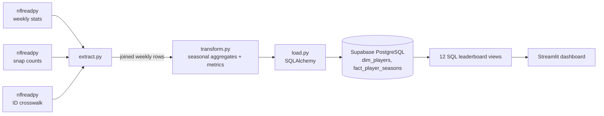
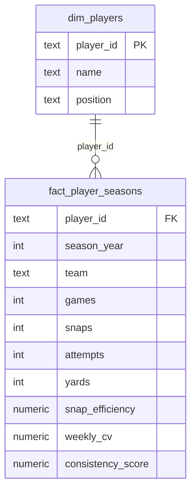

# NFL Stats Pipeline

[](https://github.com/Sunny53/nfl-stats-pipeline/actions/workflows/ci.yml)

An ETL pipeline and analytics dashboard for NFL quarterback and wide receiver performance. It pulls weekly player stats and offensive snap counts, joins them across datasets, computes custom efficiency and consistency metrics, loads a star-schema PostgreSQL database, and serves 12 leaderboard views through a Streamlit app.

**[Live dashboard](https://nfl-stats-pipeline.streamlit.app/)** (free hosting: if the app has been idle, click the wake-up button and give it about 30 seconds)

<!-- TODO: add a dashboard screenshot or GIF here, e.g.  -->

## Architecture



## Tech stack

Extraction uses `nflreadpy` for weekly stats, snap counts, and the player-ID crosswalk. Its Polars DataFrames are converted to pandas for the existing transform pipeline. This requires Python 3.10 or newer.

## Data model



Schema definitions live in `database/schema.sql` and the leaderboard views in `database/views.sql`, kept separate from the Python code so they are version-controlled and repeatable. The diagram shows the main columns only.

## Metrics

**Snap Efficiency**: yards produced per offensive snap.
- QB: `passing_yards / offensive_snaps`
- WR: `receiving_yards / offensive_snaps`

**Consistency Score**: how steady a player is week to week, based on the Coefficient of Variation (CV) of weekly yards, computed from game-level data *before* it is aggregated to seasons.

```
CV = std_dev(weekly_yards) / mean(weekly_yards)
consistency_score = max(0, 100 - (CV x 100))
```

| Score | Reading |
| --- | --- |
| 70+ | very consistent producer |
| 40-60 | boom/bust |
| 0 | extremely volatile |

Edge cases: a single-game season gets a neutral 50 (CV is undefined), and a season with zero production scores 0.

**Qualifying thresholds** (only qualified players appear in leaderboards): QB 200+ pass attempts, WR 40+ targets.

## Engineering decisions

- **Real snap counts instead of estimates.** An earlier version estimated snaps from games played. It now uses actual offensive snap counts, and players with no snap data are dropped (inner join) rather than approximated, trading coverage for accuracy.
- **Three-dataset join.** Snap counts use PFR player IDs and weekly stats use GSIS IDs, so a third ID crosswalk dataset maps one to the other before joining on player, season, and week.
- **Regular season only.** The regular-season filter is applied to the weekly and snap datasets independently so playoff games don't inflate seasonal totals.
- **Dynamic season range.** The season range is computed from the current date, so new seasons are picked up without code changes.
- **Edge cases handled explicitly.** Missing IDs, null snap counts, zero production, and single-game seasons each have defined behavior and unit tests.
- **Secure database access.** User-driven queries are parameterized, dynamic view names are checked against whitelists (`VALID_POSITIONS`, `VALID_METRICS`, `VALID_SPLITS`), secrets live in Streamlit's secrets manager or a gitignored `.env`, and nothing is hardcoded in source.

## Data quality

Extraction logs the number of snap-count rows without a PFR-to-GSIS crosswalk and weekly QB/WR rows without a snap-count match. Unmatched weekly rows remain excluded, and extraction raises an error if no rows remain.

## Leaderboard views

12 views, one per combination of position (QB, WR), metric (snap efficiency, consistency), and time split (1 year, 5 year, career), for example `vw_leaderboard_qb_consistency_5yr`. Career values are the unweighted average of a player's qualified seasons.

## Known limitations

- Season coverage depends on nflverse publishing the latest completed season's stats and snap counts. `nflreadpy` is currently marked experimental, so upstream API or data-schema changes may require follow-up adjustments.
- The load step is a full refresh (truncate, then insert) rather than an incremental upsert.
- Players without matching snap-count data are excluded, which slightly reduces coverage for early seasons.

## Run locally

```bash
git clone https://github.com/Sunny53/nfl-stats-pipeline.git
cd nfl-stats-pipeline
# Requires Python 3.10 or newer; .python-version selects 3.11 for local tooling.
python -m venv .venv
source .venv/bin/activate        # Windows: .venv\Scripts\activate
pip install -r requirements.txt
```

The root `requirements.txt` contains only the Streamlit app dependencies and is
the file Streamlit Community Cloud installs. See the [Community Cloud app
dependencies documentation](https://docs.streamlit.io/deploy/streamlit-community-cloud/deploy-your-app/app-dependencies).
To run the ETL pipeline locally, install its additional dependencies (this also
installs `requirements.txt`):

```bash
pip install -r requirements-etl.txt
```

For Streamlit Community Cloud, select Python 3.11 in the [Advanced settings
Python version dropdown](https://docs.streamlit.io/deploy/streamlit-community-cloud/deploy-your-app/deploy#optional-configure-secrets-and-python-version)
when deploying.

Create a `.env` file in the project root:

```
SUPABASE_DB_URL=your_supabase_connection_string
```

Then run the pipeline and the app:

```bash
python -m etl.pipeline
python -m streamlit run streamlit_app/app.py
```

## Tests

```bash
pip install pytest
python -m pytest -v
```

The tests cover the consistency score (including edge cases), seasonal aggregation, efficiency metrics, qualifying thresholds, and the full transform output schema. They run offline on small hand-built DataFrames, and CI runs them on every push.

## Project structure

```
nfl-stats-pipeline/
├── etl/
│   ├── extract.py        # Downloads and joins NFL data
│   ├── transform.py      # Weekly -> seasonal, metrics, thresholds
│   ├── load.py           # Writes to Supabase
│   ├── pipeline.py       # Orchestrates ETL
│   └── deploy_views.py   # Deploys the SQL views
├── database/
│   ├── schema.sql        # Table definitions
│   └── views.sql         # Leaderboard views
├── streamlit_app/        # Dashboard
├── tests/                # Unit tests
└── .github/workflows/    # CI
```

## Roadmap

- [x] Real snap counts, regular-season filtering, dynamic seasons
- [x] Real consistency score from weekly data
- [x] 12 SQL leaderboard views
- [x] Unit tests and CI
- [x] Migrate extraction from `nfl_data_py` to `nflreadpy`; include the latest completed season
- [ ] Current-season time split: add an in-progress "Current season" option alongside 1 year, 5 year, and Career in the leaderboards. It would pull the live season from nflreadpy (player stats refresh nightly after game days), use thresholds scaled to games played so far, label results as in progress, and keep the season out of the 5-year and Career views until it finishes.
- [ ] Scheduled in-season refresh: run the pipeline weekly during the season with a GitHub Actions workflow, using the database connection string stored as a repository secret.
- [ ] Clutch Performance Index
- [ ] Value Per Dollar (production relative to salary via OverTheCap)
- [ ] Fatigue Factor (short rest, travel distance, weather)
- [ ] Momentum Shifts (big play analysis)

Built by [Sunny Patel](https://github.com/Sunny53).
